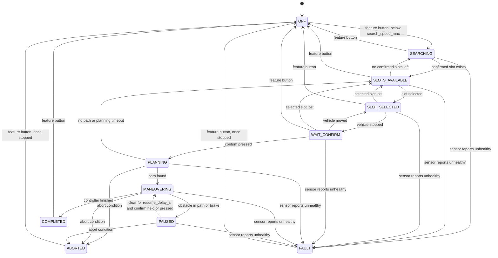

# Parking supervisor

`park_sim/supervisor.py` owns the feature's states. Each tick it takes a `SupervisorInput`
(driver inputs and system events) and returns a `SupervisorOutput` (state, controller action,
HMI message, abort reason, whether the driver must shift, plan and park requests). It uses only
the standard library, so it can become the `parking_supervisor` ROS 2 node. Thresholds are in
`config/park_params.yaml` under `supervisor:`.

## States and transitions



At most one transition happens per tick. Each one is logged in `ParkingSupervisor.transitions`
as a `Transition` with time, from, to and reason.

## Abort conditions

These apply in PLANNING, MANEUVERING and PAUSED, the states where the system has the car, and
act on the tick they are seen. The first match sets the reason.

| Reason | Condition |
|---|---|
| `steering_override` | \|driver torque\| above `driver_override_nm` |
| `accelerator_override` | accelerator above `accelerator_override` |
| `gear_request` | the driver requests any gear |
| `door_open` | a door is open |
| `seatbelt_off` | the seatbelt is off |
| `sensor_stale` | a sensor's last update is older than its entry in `sensor_timeouts_s`, or it is missing |
| `overspeed` | \|speed\| above `maneuver_speed_max` |
| `maneuver_timeout` | over `max_time_s` since the maneuver began, pauses included |
| `too_many_gear_changes` | gear changes above `max_gear_changes` |
| `driver_cancel` | feature button pressed |
| `obstacle_timeout` | PAUSED only: blocked by an obstacle for over `abort_after_s` (see [safety.md](safety.md)) |

After an abort the action is `stop` until the car is below `standstill_speed`, then `hold` with
`driver_must_shift` set, until the driver presses the feature button.

## Controller action by state

| State | Action |
|---|---|
| OFF, SEARCHING, SLOTS_AVAILABLE, SLOT_SELECTED, WAIT_CONFIRM | `none` (the driver has the car) |
| PLANNING | `hold` |
| MANEUVERING | `drive` |
| PAUSED | `stop`, then `hold` once stopped |
| COMPLETED | `hold`, with `request_park` set |
| ABORTED, FAULT | `stop`, then `hold` once stopped; `none` if the system never had the car |

## Decisions the rules left open

- **Where aborts apply:** only once the driver has confirmed. Before that the driver is driving,
  so steering, throttle and shifting are normal.
- **FAULT:** a sensor that reports `healthy=False` goes to FAULT (`sensor_unhealthy`) from any state
  except OFF and the end states. Stale data follows the ABORTED rule and takes priority if both apply.
- **Leaving the end states:** the feature button returns COMPLETED, ABORTED and FAULT to OFF,
  ABORTED and FAULT only once stopped. The same button cancels at any earlier point.
- **Buttons:** the feature button acts on the press. Starting from WAIT_CONFIRM also needs a new
  press of confirm, so a button already held down cannot start a maneuver. Resuming from PAUSED
  only needs confirm to be down.
- **Lost slots:** a selected slot that stops being confirmed before PLANNING returns to SLOTS_AVAILABLE.
  After that the slot list is ignored.
- **Planner results:** a result for a different slot than the selected one is ignored, so a late
  reply cannot start a maneuver. No result within `planning_timeout_s` counts as no path.
- **Added inputs and outputs:** `t` and `gear_changes` on the input (the gear limit needs a count);
  `request_plan`, `plan_slot_id` and `request_park` on the output.
- **Not handled:** driving above `search_speed_max` after SEARCHING has begun does not end the search.

## In the simulator

`simulator.run_closed_loop` runs everything through the supervisor, with
`scripted_driver.ScriptedDriver` pressing the feature button, selecting the target stall, then
pressing and holding confirm. The car waits at the start pose until the maneuver begins, because
driving to the slot is not modeled. The run clock starts at the first tick; `time_s` and the other
metrics cover only the maneuver, so they compare directly with runs from before the supervisor.

`events` injects inputs. Each entry is `(time, overrides)` on the run clock, and an override stays
in force until a later event replaces it:

```python
run_closed_loop(sc, events=[(4.0, {"brake": 0.5}), (4.5, {"brake": 0.0})])   # brake tap
run_closed_loop(sc, events=[(3.0, {"steering_torque_nm": 5.0})])             # torque spike
```

A pressed brake acts through the supervisor's `stop` action. With the safety monitor on, that action also
asks the plant's brake model for its service deceleration; in a plain run the speed loop does the stopping
(see [safety.md](safety.md)).

`simulator.run_search` runs the same supervisor with the car driving down an aisle first, so
SEARCHING and SLOTS_AVAILABLE last as long as the search does. See [search.md](search.md).

MCAP files carry the state, action, reasons and HMI message on `/supervisor` every tick, and the
full transition log in `/metrics`.
